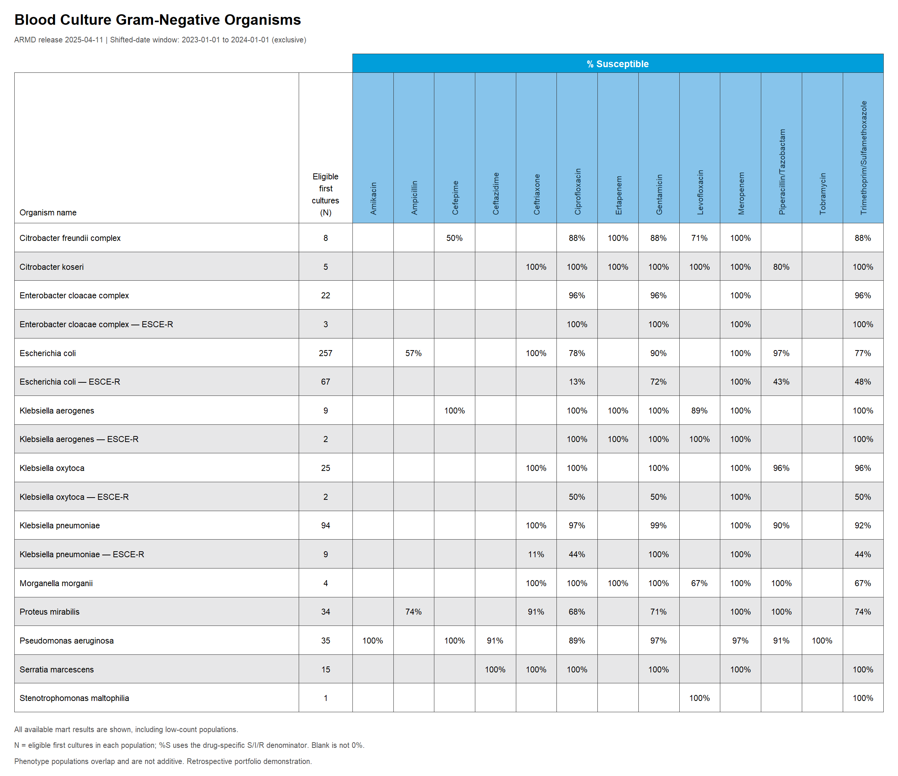
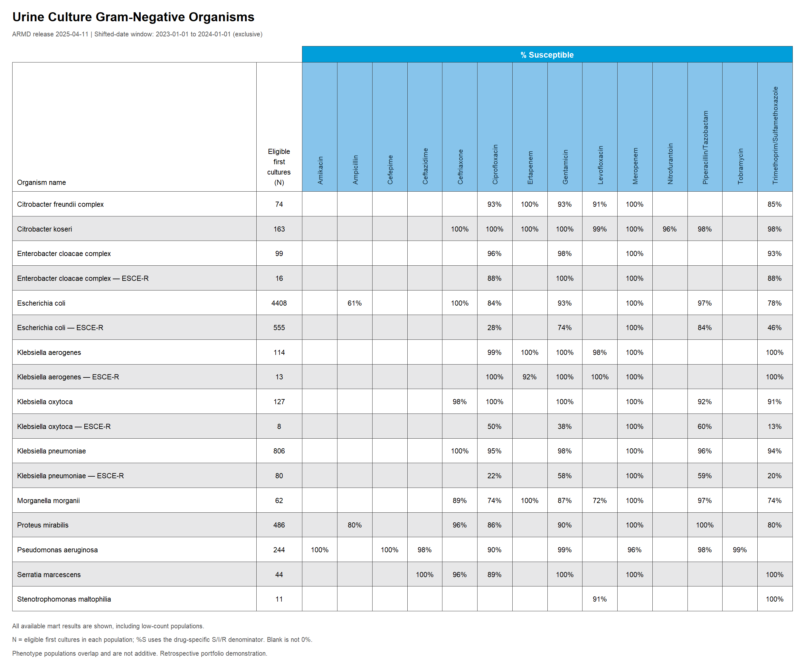
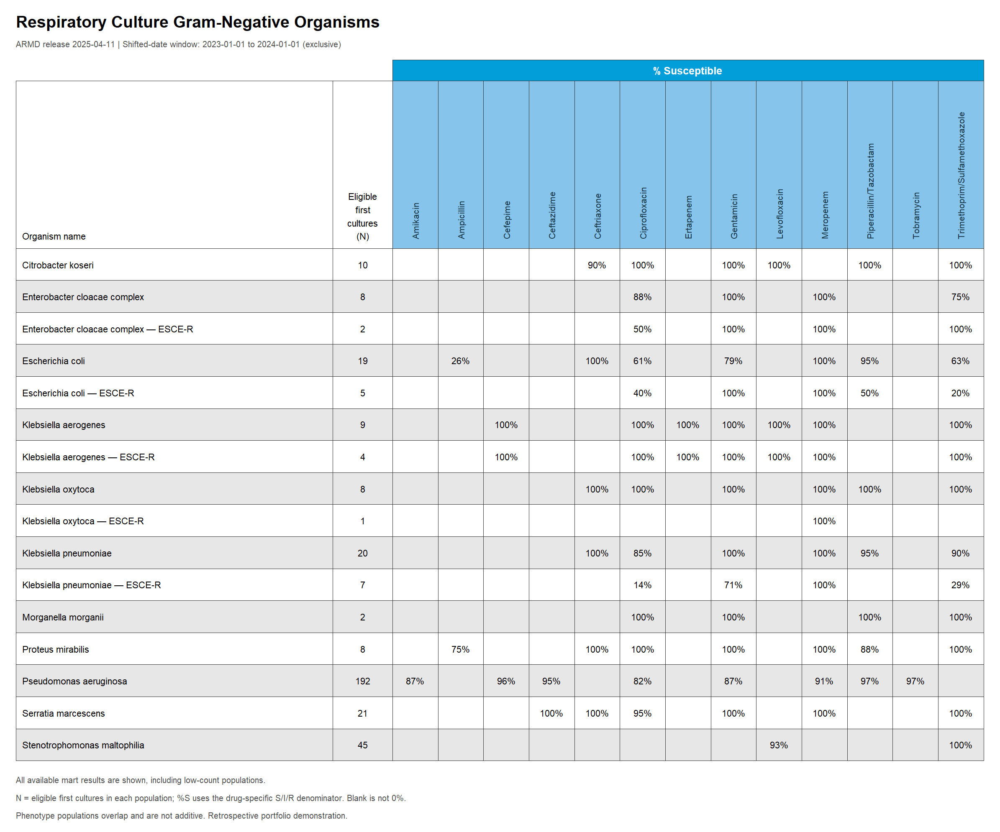
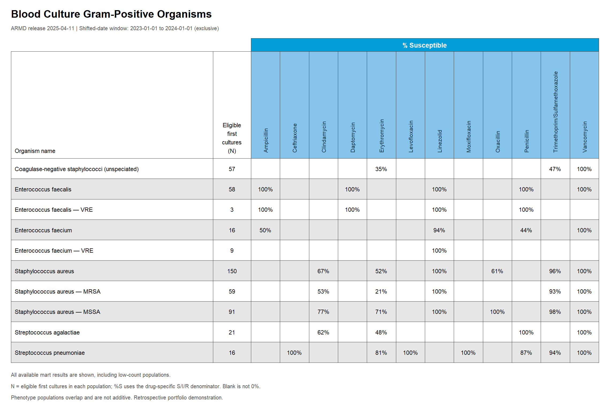
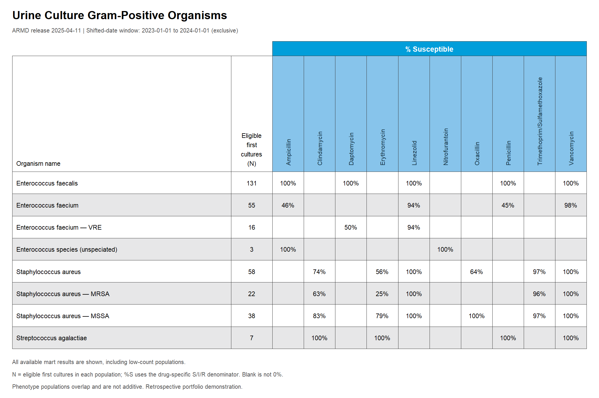
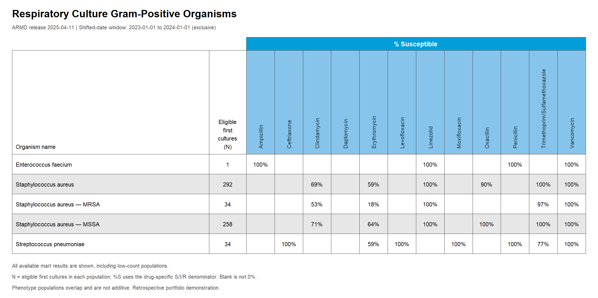

Plot the ARMD Antibiogram with R
================
Brenden Clark

- [1. Load the mart](#1-load-the-mart)
- [2. Check the reporting grain](#2-check-the-reporting-grain)
- [3. Prepare the chart layout](#3-prepare-the-chart-layout)
- [4. Draw and save the charts](#4-draw-and-save-the-charts)
- [5. Blood culture Gram-negative
  organisms](#5-blood-culture-gram-negative-organisms)
- [6. Urine culture Gram-negative
  organisms](#6-urine-culture-gram-negative-organisms)
- [7. Respiratory culture Gram-negative
  organisms](#7-respiratory-culture-gram-negative-organisms)
- [8. Blood culture Gram-positive
  organisms](#8-blood-culture-gram-positive-organisms)
- [9. Urine culture Gram-positive
  organisms](#9-urine-culture-gram-positive-organisms)
- [10. Respiratory culture Gram-positive
  organisms](#10-respiratory-culture-gram-positive-organisms)

This notebook uses **ggplot2** to visualize the existing susceptibility
mart as six antibiogram tables: blood, urine, and respiratory cultures,
each divided into Gram-positive and Gram-negative organisms.

The only data input is `data/exports/mart_susceptibility.csv`. Organism
rows and antibiotic columns are derived from that file and sorted
alphabetically. These are unfiltered exploratory antibiograms: every available mart row is included, including small populations flagged `insufficient_data`, to keep low-count organisms visible. `%S`
comes from `susceptible_pct`, and `N` is the population’s
`eligible_count`, displayed once rather than summed across antibiotics.
Missing percentages stay blank; true zero susceptibility is displayed as
`0%`.

**Packages:** ggplot2 for plotting, with knitr and rmarkdown for
knitting. Open this file in RStudio and Knit, or run
`rmarkdown::render("R/plot_antibiogram.Rmd", encoding = "UTF-8")` from
the repository root. PNGs are saved in `docs/figures/antibiogram/r/`.

## 1. Load the mart

``` r
library(ggplot2)
knitr::opts_chunk$set(echo = TRUE, message = FALSE, out.width = "100%")

mart_relative_path = "data/exports/mart_susceptibility.csv"
# To use the local R build, choose "data/processed/mart_susceptibility_r.csv".

find_repository_root = function(start = getwd()) {
  path = normalizePath(start, winslash = "/", mustWork = TRUE)
  repeat {
    if (file.exists(file.path(path, mart_relative_path))) return(path)
    parent = dirname(path)
    if (identical(parent, path)) stop("The selected mart CSV was not found in this folder or its parents.")
    path = parent
  }
}

root = find_repository_root()
output_dir = file.path(root, "docs/figures/antibiogram/r")
dir.create(output_dir, recursive = TRUE, showWarnings = FALSE)
mart = read.csv(file.path(root, mart_relative_path), encoding = "UTF-8",
                stringsAsFactors = FALSE, check.names = FALSE,
                na.strings = c("", "NA", "null", "NULL"))
```

## 2. Check the reporting grain

A chart must contain one release and reporting window. Duplicate
organism-antibiotic endpoints and inconsistent population counts cause
an error instead of being aggregated.

``` r
required = c("cohort_id", "gram_stain_group", "organism_name", "antibiotic",
             "eligible_count", "susceptible_pct", "source_version",
             "analysis_window_start", "analysis_window_end_exclusive")
missing_columns = setdiff(required, names(mart))
if (length(missing_columns)) stop(paste("Missing columns:", paste(missing_columns, collapse = ", ")))
for (column in c("cohort_id", "gram_stain_group", "organism_name", "antibiotic")) {
  if (anyNA(mart[[column]])) stop(paste("Missing labels in", column))
  mart[[column]] = trimws(mart[[column]])
}
for (column in c("eligible_count", "susceptible_pct")) {
  original = mart[[column]]
  mart[[column]] = suppressWarnings(as.numeric(original))
  if (any(is.na(mart[[column]]) & !is.na(original))) stop(paste("Nonnumeric values in", column))
}
if (anyNA(mart$eligible_count) || any(mart$eligible_count < 0 | mart$eligible_count %% 1 != 0)) stop("Invalid eligible culture counts")
if (any(mart$susceptible_pct < 0 | mart$susceptible_pct > 100, na.rm = TRUE)) stop("Percentages must be on a 0-100 scale")
scope_columns = c("source_version", "analysis_window_start", "analysis_window_end_exclusive")
scope = unique(mart[scope_columns])
if (nrow(scope) != 1) stop("Select one release and reporting window before plotting.")
scope[is.na(scope)] = "full-release"
endpoint_key = c("cohort_id", "gram_stain_group", "organism_name", "antibiotic")
if (anyDuplicated(mart[endpoint_key])) stop("Duplicate organism-antibiotic endpoints")
population_key = c("cohort_id", "gram_stain_group", "organism_name")
counts = unique(mart[c(population_key, "eligible_count")])
if (anyDuplicated(counts[population_key])) stop("Inconsistent counts within an organism population")
```

## 3. Prepare the chart layout

The selected specimen and Gram group determine which rows and columns
appear. Percentages are placed in a matrix without recalculating them or
filling missing values with zero.

``` r
prepare_panel = function(cohort, gram) {
  selected = mart[mart$cohort_id == cohort & mart$gram_stain_group == gram, , drop = FALSE]
  if (!nrow(selected)) stop(paste("No data for", cohort, gram))
  organisms = sort(unique(selected$organism_name), method = "radix")
  antibiotics = sort(unique(selected$antibiotic), method = "radix")
  values = matrix(NA_real_, nrow = length(organisms), ncol = length(antibiotics),
                  dimnames = list(organisms, antibiotics))
  positions = cbind(match(selected$organism_name, organisms), match(selected$antibiotic, antibiotics))
  values[positions] = selected$susceptible_pct
  labels = matrix("", nrow = nrow(values), ncol = ncol(values), dimnames = dimnames(values))
  nonmissing = !is.na(values)
  labels[nonmissing] = paste0(floor(values[nonmissing] + 0.5), "%")
  counts = selected$eligible_count[match(organisms, selected$organism_name)]
  names(counts) = organisms
  list(values = values, labels = labels, counts = counts)
}
```

## 4. Draw and save the charts

`geom_rect()` draws the cells and headers, while `geom_text()` adds
organism names, eligible culture counts, and percentages. The same
function is reused for all six tables.

``` r
plot_antibiogram = function(title, table) {
  labels = table$labels
  row_height = 0.43
  organism_width = 4.25
  count_width = 0.80
  drug_width = 0.61
  header_height = 2.25
  band_height = 0.28
  nr = nrow(labels)
  nc = ncol(labels)
  body_height = nr * row_height
  start_drugs = organism_width + count_width
  width = start_drugs + nc * drug_width
  top = body_height + header_height + band_height

  rows = data.frame(i = seq_len(nr), organism = rownames(labels), count = unname(table$counts),
                    y = body_height - (seq_len(nr) - 0.5) * row_height,
                    fill = rep(c("#ffffff", "#e7e7e8"), length.out = nr))
  rows$label = vapply(rows$organism, function(x) paste(strwrap(x, width = 48), collapse = "\n"), character(1))
  cells = expand.grid(i = seq_len(nr), j = seq_len(nc))
  cells$x = start_drugs + (cells$j - 0.5) * drug_width
  cells$y = rows$y[cells$i]
  cells$fill = rows$fill[cells$i]
  cells$label = labels[cbind(cells$i, cells$j)]
  headers = data.frame(x = start_drugs + (seq_len(nc) - 0.5) * drug_width, label = colnames(labels))
  p = ggplot() +
    geom_rect(data = rows, aes(xmin = 0, xmax = organism_width, ymin = y - row_height/2, ymax = y + row_height/2, fill = fill), colour = "#333333", linewidth = 0.15) +
    geom_rect(data = rows, aes(xmin = organism_width, xmax = start_drugs, ymin = y - row_height/2, ymax = y + row_height/2, fill = fill), colour = "#333333", linewidth = 0.15) +
    geom_rect(data = cells, aes(xmin = x - drug_width/2, xmax = x + drug_width/2, ymin = y - row_height/2, ymax = y + row_height/2, fill = fill), colour = "#333333", linewidth = 0.15) +
    geom_text(data = rows, aes(x = 0.08, y = y, label = label), hjust = 0, size = 3.1, lineheight = 0.95) +
    geom_text(data = rows, aes(x = organism_width + count_width/2, y = y, label = count), size = 3.1) +
    geom_text(data = cells, aes(x = x, y = y, label = label), size = 3.1) +
    annotate("rect", xmin = 0, xmax = organism_width, ymin = body_height, ymax = body_height + header_height, fill = "white", colour = "#333333", linewidth = 0.15) +
    annotate("rect", xmin = organism_width, xmax = start_drugs, ymin = body_height, ymax = body_height + header_height, fill = "white", colour = "#333333", linewidth = 0.15) +
    annotate("text", x = 0.08, y = body_height + 0.12, label = "Organism name", hjust = 0, vjust = 0, size = 3.1) +
    annotate("text", x = organism_width + count_width/2, y = body_height + 0.12, label = "Eligible\nfirst\ncultures\n(N)", vjust = 0, size = 3.1) +
    geom_rect(data = headers, aes(xmin = x - drug_width/2, xmax = x + drug_width/2), ymin = body_height, ymax = body_height + header_height, fill = "#87c4eb", colour = "#333333", linewidth = 0.15) +
    geom_text(data = headers, aes(x = x, label = label), y = body_height + 0.12, angle = 90, hjust = 0, size = 2.95, colour = "#173747") +
    annotate("rect", xmin = start_drugs, xmax = width, ymin = body_height + header_height, ymax = top, fill = "#019eda", colour = "#333333", linewidth = 0.15) +
    annotate("text", x = (start_drugs + width)/2, y = top - band_height/2, label = "% Susceptible", colour = "white", fontface = "bold", size = 3.5) +
    annotate("text", x = 0, y = top + 0.52, label = title, hjust = 0, fontface = "bold", size = 5.5) +
    annotate("text", x = 0, y = top + 0.22, hjust = 0, colour = "#555555", size = 2.8,
             label = paste0("ARMD release ", scope$source_version, " | Shifted-date window: ", scope$analysis_window_start, " to ", scope$analysis_window_end_exclusive, " (exclusive)")) +
    annotate("text", x = 0, y = -0.25, label = "All available mart results are shown, including low-count populations.", hjust = 0, colour = "#555555", size = 2.8) +
    annotate("text", x = 0, y = -0.49, label = "N = eligible first cultures in each population; %S uses the drug-specific S/I/R denominator. Blank is not 0%.", hjust = 0, colour = "#555555", size = 2.8) +
    annotate("text", x = 0, y = -0.73, label = "Phenotype populations overlap and are not additive. Retrospective portfolio demonstration.", hjust = 0, colour = "#555555", size = 2.8) +
    scale_fill_identity() +
    coord_fixed(xlim = c(-0.08, width + 0.08), ylim = c(-0.90, top + 0.75), expand = FALSE, clip = "off") +
    theme_void(base_family = "sans") +
    theme(plot.background = element_rect(fill = "white", colour = NA), plot.margin = margin(4, 4, 4, 4))
  list(plot = p, width = width + 0.3, height = top + 1.65)
}


render_panel = function(cohort, gram) {
  table = prepare_panel(cohort, gram)
  gram_title = if (gram == "gram_negative") "Gram-Negative" else "Gram-Positive"
  title = paste(tools::toTitleCase(cohort), "Culture", gram_title, "Organisms")
  result = plot_antibiogram(title, table)
  png_path = file.path(output_dir, paste0(cohort, "_", gram, ".png"))
  ggsave(png_path, result$plot, width = result$width, height = result$height,
         dpi = 180, bg = "white")
  knitr::include_graphics(png_path)
}
```

## 5. Blood culture Gram-negative organisms

``` r
render_panel("blood", "gram_negative")
```



## 6. Urine culture Gram-negative organisms

``` r
render_panel("urine", "gram_negative")
```



## 7. Respiratory culture Gram-negative organisms

``` r
render_panel("respiratory", "gram_negative")
```



## 8. Blood culture Gram-positive organisms

``` r
render_panel("blood", "gram_positive")
```



## 9. Urine culture Gram-positive organisms

``` r
render_panel("urine", "gram_positive")
```



## 10. Respiratory culture Gram-positive organisms

``` r
render_panel("respiratory", "gram_positive")
```


