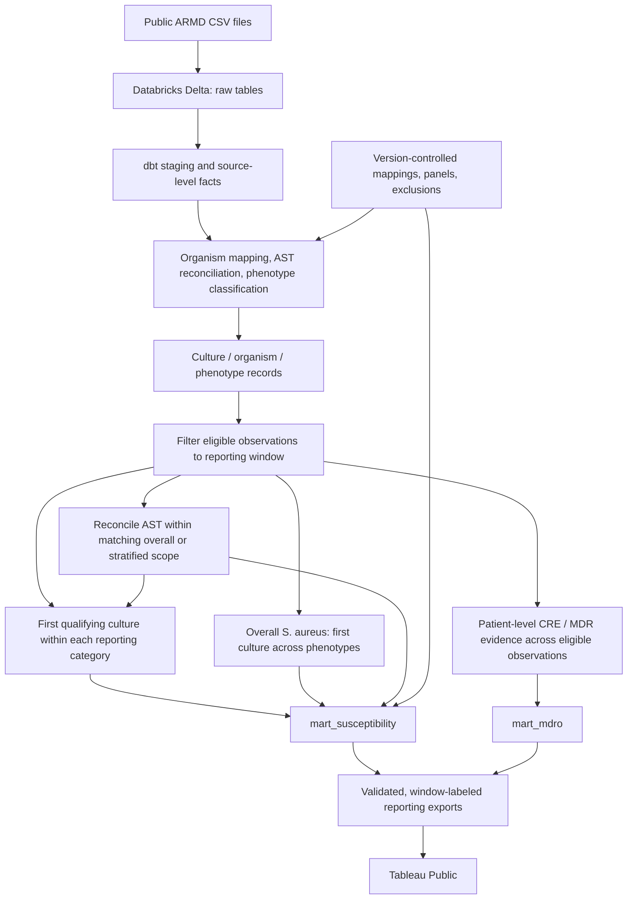
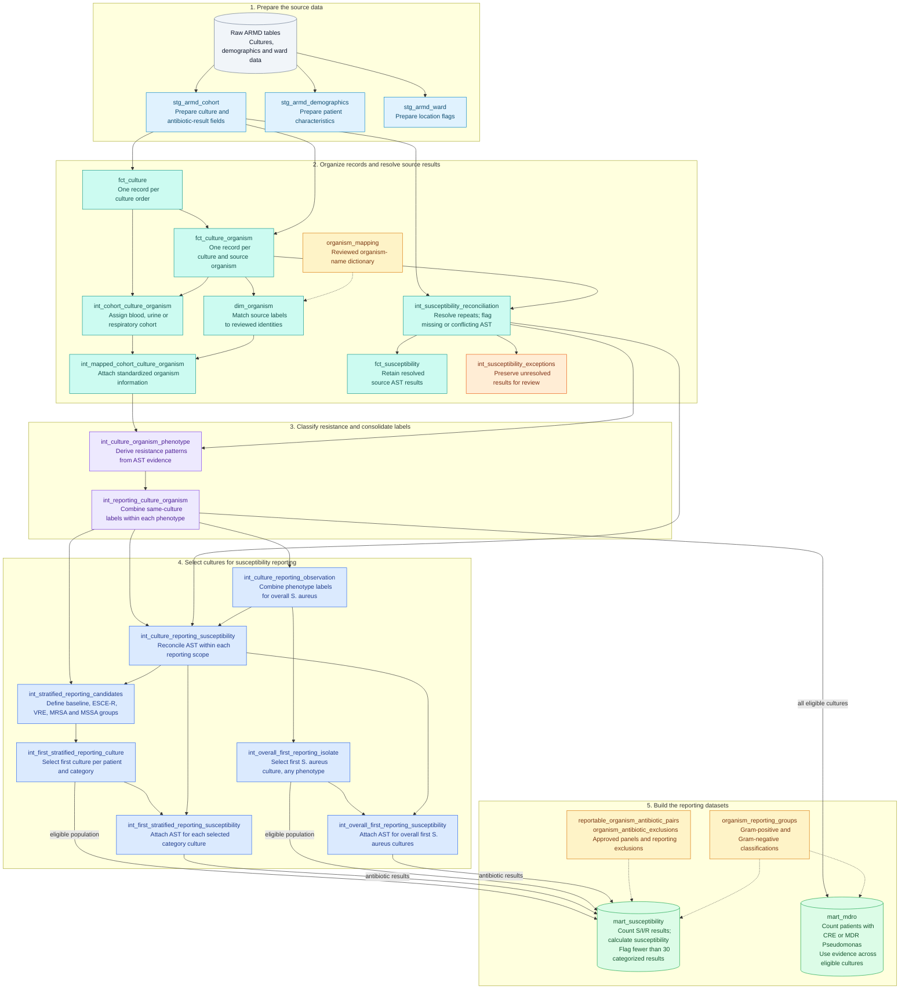

# Clinical Microbiology Analytics Lakehouse

**A reproducible antibiogram and antimicrobial resistance analytics portfolio project**  
**Databricks | Delta Lake | SQL | dbt | Python | R | Tableau Public**

[**Explore the interactive antibiogram on Tableau Public**](https://public.tableau.com/views/ARMDAntibiogram/BloodCultureGram-NegativeOrganisms?:language=en-US&publish=yes&:sid=&:redirect=auth&:display_count=n&:origin=viz_share_link)

## Project overview

I use clinical microbiology data to monitor laboratory quality and antimicrobial susceptibility. This project applies that experience to the public ARMD dataset, producing susceptibility and MDRO reporting marts with Databricks/dbt, a Tableau antibiogram, and R and Python implementations of the susceptibility workflow.

The clinical data I work with professionally may contain **protected health information (PHI)** and cannot be published in a personal portfolio. Instead, this project uses the publicly available, de-identified **Antibiotic Resistance Microbiology Dataset (ARMD)** to demonstrate similar analytical methods and reporting decisions **without using data from my employer**.

I developed a version-controlled **extract, load, transform (ELT)** pipeline to convert source culture and antimicrobial susceptibility testing (AST) records into two validated reporting datasets: a specimen-stratified susceptibility mart and a multidrug-resistant organism (MDRO) mart. The susceptibility results are visualized as an interactive Tableau Public antibiogram.

I also rebuilt the susceptibility workflow in **R and Python** as a learning exercise and portfolio extension. These implementations demonstrate the same data preparation, reporting logic, and validation across languages, using the dbt-generated dashboard dataset as the comparison reference. See [R and Python implementations](#r-and-python-implementations) for the notebooks and recorded results.

> **Scope:** This is a retrospective research demonstration using source-reported AST categories. It is not an official institutional antibiogram, a fully CLSI M39-compliant implementation, or clinical decision support.

## Interactive Tableau antibiogram

**[Open the published Tableau Public workbook](https://public.tableau.com/views/ARMDAntibiogram/BloodCultureGram-NegativeOrganisms?:language=en-US&publish=yes&:sid=&:redirect=auth&:display_count=n&:origin=viz_share_link)**

The workbook presents **unfiltered exploratory antibiograms** for blood, urine, and respiratory cultures, with separate Gram-positive and Gram-negative views, plus an MDRO summary. Both marts use the shifted-date window **2023-01-01 inclusive through 2024-01-01 exclusive**. Ordinary (`base`) and resistance-phenotype populations are selected independently; *Staphylococcus aureus* also has an overall population alongside separately selected MRSA and MSSA populations.

I chose to retain low-count percentages in the exploratory antibiograms so commonly isolated organisms remain visible even when this research window contains few observations. The mart still marks organism–antibiotic rows with fewer than 30 categorized S/I/R results as `insufficient_data`; the Tableau, ggplot2, and Matplotlib views intentionally include them. These small-denominator percentages are descriptive and should not be treated as reliable estimates for clinical reporting. Approved-panel rules and explicit organism–antibiotic exclusions still apply. Blank cells are not 0%: a pair may be outside the panel, explicitly excluded, or have no categorized result.

**How to interpret the tables:** `%S` is the percentage of **categorized S/I/R endpoints** that are classified as susceptible for a particular organism–antibiotic combination. Each reporting category has its own first-qualifying-culture population, distinct from the drug-specific categorized count. Patients can contribute to more than one category, so category counts are not additive unique-patient totals. Because ARMD lacks verified biological isolate identifiers, the analytical first-culture counts should not be construed as individually verified strains. See [Metric definitions](docs/metric_definitions.md) for denominators, exclusions, and limitations.

Reporting scope is retained in each exported mart as `analysis_window_start` and `analysis_window_end_exclusive`. For the susceptibility tables, **N** is the eligible first-culture population; **%S** uses the drug-specific S/I/R denominator. Phenotype populations overlap and are not additive. These are shifted-date, retrospective research summaries.

### Tableau connection and publication approach

For this portfolio demonstration, the validated reporting marts are **exported from Databricks** for use in Tableau Public. Tableau workbook and extract files are intentionally not tracked in this GitHub repository; the published interactive workbook is available through the link above.

In a typical internal clinical analytics environment, I would **connect Tableau directly to the curated Databricks data source**, rather than manually maintaining exported CSVs. That allows visualizations to consume centrally maintained tables, with refreshes coordinated through the data pipeline and supported Tableau connection/refresh capabilities. Such a deployment would also require institutional access controls and PHI governance; Tableau Public is not appropriate for protected clinical data.

## Public data source

**[Antibiotic Resistance Microbiology Dataset (ARMD)](https://doi.org/10.5061/dryad.jq2bvq8kp)** — Nateghi Haredasht and colleagues; **April 11, 2025 release**.

| Source file | Role in the project |
|---|---|
| `microbiology_cultures_cohort.csv` | Culture orders, organism observations, and source-reported AST |
| `microbiology_cultures_demographics.csv` | Supporting demographic and encounter information |
| `microbiology_cultures_ward_info.csv` | Supporting ward and location information |

The current analytical cohorts are **blood, urine, and respiratory** cultures. The source uses shifted, de-identified culture timestamps, which support within-dataset ordering but should not be interpreted as actual clinical calendar dates. **The ARMD release date is not the period covered by a clinical annual antibiogram.**

## Data pipeline architecture



### Responsibilities across tools

Databricks stores the raw and curated tables. The reporting rules live in dbt models and version-controlled reference seeds. Tableau consumes the exported marts; the R and Python builds independently reproduce the susceptibility mart's counts and percentages. SQL validation notebooks document source investigation and reporting checks.

## R and Python implementations

I developed these alternative implementations to show how the same analytical problem can be solved with different tools and to demonstrate **R and Python skills alongside Databricks, SQL, and dbt**. The Databricks/dbt project remains the primary ELT pipeline. Each local build starts with the original ARMD cultures CSV and shares the reviewed organism mappings, antibiotic panels, and exclusions in [`dbt/seeds/`](dbt/seeds/).

| Implementation | Portfolio walkthrough | Source | Separate CSV output |
|---|---|---|---|
| **R** — tidyverse, lubridate, janitor, digest | [Rendered R report with code and results](R/build_mart_susceptibility.md) | [R Markdown source](R/build_mart_susceptibility.Rmd) | `data/processed/mart_susceptibility_r.csv` |
| **Python** — pandas, NumPy | [Jupyter notebook with code and results](notebooks/python_build/build_mart_susceptibility.ipynb) | Same notebook | `data/processed/mart_susceptibility_python.csv` |

Both builds reproduce the transformations behind [`mart_susceptibility`](dbt/models/marts/mart_susceptibility.sql): source cleaning, culture consolidation, AST conflict reconciliation, organism mapping, resistance-phenotype classification, first-qualifying-culture selection, reporting exclusions, and susceptibility calculations. The existing `data/exports/mart_susceptibility.csv` used by Tableau is read at the final comparison stage; it does not supply the calculated mart values.

**Recorded validation:** for the `2025-04-11` ARMD release and the shifted-date window `2023-01-01` through `2024-01-01` (exclusive), both saved runs match all **396 row identities and 8,316 values across 21 nonkey fields**, with zero missing rows, extra rows, or field mismatches. Each output has **26 columns**. Equality is checked using parsed values and natural keys, so CSV formatting and row order can differ.

After the dbt mart has been built and exported, the local builds run independently of each other without a live Databricks connection. Each document runs in order within one session; the R source uses paths relative to `R/`, while the Python notebook locates the repository root. The comparison CSV is produced by the dbt reproduction steps below, not supplied as a tracked input. These implementations reproduce the susceptibility mart; the separate MDRO mart remains part of the dbt pipeline.

### Unfiltered exploratory antibiograms with ggplot2 and Matplotlib

I also recreated the exploratory antibiogram tables with **ggplot2 in R** and **Matplotlib in Python**. Both notebooks read `data/exports/mart_susceptibility.csv` and generate six tables covering blood, urine, and respiratory cultures, with separate Gram-positive and Gram-negative views. Organism rows, antibiotic columns, counts, and susceptibility percentages come directly from the mart, including rows flagged `insufficient_data`. Figure footnotes identify the low-count display choice, denominator definitions, and reporting window.

- **R / ggplot2:** [R Markdown notebook](R/plot_antibiogram.Rmd) and [rendered report with code and charts](R/plot_antibiogram.md).
- **Python / Matplotlib:** [Jupyter notebook with code and charts](notebooks/python_build/plot_antibiogram.ipynb).

Each notebook runs independently and saves PNG figures in `docs/figures/antibiogram/r/` or `docs/figures/antibiogram/python/`, respectively.

## Key analytical and modeling decisions

1. **Preserve source grain and provenance.** Culture orders, source culture–organism observations, and organism–antibiotic endpoints are separate. Reviewed mappings retain the original labels and qualifiers.
2. **Keep ambiguous AST visible.** Reconciliation retains missing and conflicting endpoints. The shared reporting reconciliation uses all source labels for overall *S. aureus*, and only labels within the selected phenotype category for stratified results.
3. **Filter the period before selecting cultures.** The optional 12-month window limits eligible observations before patient-level ranking and MDRO aggregation. 
4. **Select each phenotype population independently.** Ordinary (`base`), ESCE-R, VRE, MRSA, and MSSA categories select their first qualifying culture per patient/cohort/organism/category. One patient can enter multiple categories. `base` is a reporting category, not proof of wild-type susceptibility. Overall *S. aureus* separately uses its first culture regardless of phenotype.
5. **Keep MDRO evidence separate.** CRE and MDR *Pseudomonas aeruginosa* reporting records do not enter the main susceptibility categories. `mart_mdro` summarizes their patient-level evidence across eligible observations in the same window, with positive evidence taking precedence over not-evaluable and not-detected evidence.
6. **Separate reporting controls from exploratory display.** Reviewed cohort-specific organism–antibiotic approvals and cohort/category-scoped exclusions determine the panel. A `*` scope applies a rule to all cohorts or categories. The mart flags fewer than 30 categorized S/I/R results as `insufficient_data`; the exploratory antibiograms deliberately retain those percentages to show low-count organism populations.

### Validated reporting datasets

| dbt mart | Analytical grain and purpose |
|---|---|
| `mart_susceptibility` | Source release × specimen cohort × organism reporting group × reporting category × approved antibiotic, within the configured window. Reports category-specific eligible and categorized counts, S/I/R counts, `% susceptible`, testing coverage, and display status. |
| `mart_mdro` | Source release × specimen cohort × base organism × MDRO phenotype, within the configured window. Summarizes patient-level CRE and MDR *P. aeruginosa* evidence, including positive, not-detected, and not-evaluable counts, phenotype proportion, and evaluability. |

The pipeline uses susceptibility categories **as supplied by ARMD**; it does not reconstruct MIC values or reinterpret results under contemporary breakpoints. Detailed formulas, phenotype definitions, and clinical limitations are in [Metric definitions](docs/metric_definitions.md).

**Current recorded results:** the saved dbt build completed on October 13, 2026, at 11:30 p.m. Eastern with **22 models, four reference seeds, and 229 passing data tests**. The 2023 exports contain **396 susceptibility rows** (187 meeting the minimum-30 flag and 209 flagged `insufficient_data`) and **32 MDRO rows**. The saved R and Python comparisons match the susceptibility export as described above. Earlier validation-notebook outputs are labeled as historical where their window or reporting rules differ.

### How the MDRO mart is built

`mart_mdro` answers: **How many eligible patients had evidence of CRE or multidrug-resistant *Pseudomonas aeruginosa* during the reporting period?** It evaluates **all eligible culture observations**, rather than selecting only each patient's first culture.

Resistance statuses are derived upstream in `int_culture_organism_phenotype` from reconciled AST results. Original organism-name qualifiers remain traceable, but do not establish resistance on their own.

| MDRO phenotype | Project rule for positive evidence |
|---|---|
| **CRE** — carbapenem-resistant Enterobacterales | A resolved `Resistant` result to a qualifying carbapenem in a reviewed eligible organism, with documented organism-specific exceptions. |
| **MDR *P. aeruginosa*** | Resolved `Intermediate` or `Resistant` results in at least **three of six reviewed antimicrobial categories**. Incomplete testing remains not evaluable when the unknown categories could change the classification. |

After source labels are consolidated in `int_reporting_culture_organism`, the mart:

1. **Filters the population.** Apply the configured reporting window and exclude observations where the specific phenotype is `not_applicable`.
2. **Assigns one patient-level status.** Group by source release, specimen cohort, patient, and base organism. Any positive observation makes the patient group `positive`; otherwise, any `not_evaluable` observation takes precedence over `not_detected`.
3. **Summarizes the patient groups.** Count positive, not-detected, and not-evaluable groups for each source release × cohort × base organism × MDRO phenotype. Repeated cultures do not count the same patient twice within that analysis.
4. **Adds reporting fields.** Calculate phenotype and evaluability percentages, retain the reporting-window dates, and join Gram classification from `organism_reporting_groups`.

| Output | Calculation |
|---|---|
| `denominator_count` | `positive_count + not_detected_count + not_evaluable_count` |
| `phenotype_pct` | `100 × positive_count / denominator_count` |
| `evaluable_pct` | `100 × (positive_count + not_detected_count) / denominator_count` |

**Not-evaluable patient groups remain in the denominator and are not classified as negative.** The phenotype percentage therefore describes all eligible patient–organism groups, rather than only those with determinate AST evidence. A patient can contribute to different cohorts or organisms, so these counts are not additive unique-patient totals. Full drug definitions and exceptions are in [Metric definitions](docs/metric_definitions.md).

## Scope of the implementation

This is a fixed-release retrospective batch pipeline with an optional 12-month shifted-date research window. It demonstrates within-window culture selection and reporting validation. Routine institutional reporting would also require governed clinical data, real event timestamps, reviewed reporting policies, and scheduled ingestion and refreshes. A rolling report would need to recalculate first-eligible cultures within each window, rather than filter a previously selected full-release population.

## Repository guide

| Path | What it contains |
|---|---|
| `dbt/models/staging/` | ARMD staging and existing culture/AST core models |
| `dbt/models/intermediate/` | AST reconciliation, mapping, phenotype evaluation, and reporting-population logic |
| `dbt/models/marts/` | Final susceptibility and MDRO marts |
| `dbt/seeds/` | Reviewed organism mappings, Gram groups, antibiotic approvals, and exclusions |
| `dbt/tests/` | Custom data-quality and reporting-policy assertions |
| `notebooks/source_exploration/` | Source profiling and initial grain assessment |
| [`notebooks/pipeline_validation/`](notebooks/pipeline_validation/) | Source profiling and validation history; notebooks 13-14 document the current reporting design and window |
| [`R/build_mart_susceptibility.md`](R/build_mart_susceptibility.md) | R implementation with code and recorded results; editable source in [`R/build_mart_susceptibility.Rmd`](R/build_mart_susceptibility.Rmd) |
| [`notebooks/python_build/build_mart_susceptibility.ipynb`](notebooks/python_build/build_mart_susceptibility.ipynb) | Python implementation with code and recorded results |
| `dbt/macros/analysis_window.sql` | Inclusive start / exclusive 12-month end and window metadata |
| `docs/metric_definitions.md` | Detailed metric definitions, methodology, and limitations |
| [`docs/figures/antibiogram/`](docs/figures/antibiogram/) | Current ggplot2 and Matplotlib PNG figures |
| [`sql/load_raw.sql`](sql/load_raw.sql) / [`sql/validate_raw.sql`](sql/validate_raw.sql) | Raw Delta ingestion and source row-count checks |
| [`tests/test_scoped_exclusions.py`](tests/test_scoped_exclusions.py) | Offline regression checks for scoped reporting exclusions |
| `data/exports/` | Reporting extracts produced from the validated marts, when published |

### Data transformations

<details>
<summary>Model-by-model transformation diagram</summary>

The dbt pipeline turns raw culture records into two reporting datasets. Each box names a model and summarizes its transformation. AST means antimicrobial susceptibility testing; MDRO means multidrug-resistant organism. Dashed arrows show reference-data lookups.



- **Susceptibility reporting:** baseline and resistance categories select their first qualifying cultures independently. S. aureus also has an overall first-culture population. CRE and MDR Pseudomonas categories are reserved for the separate MDRO summary. A patient may appear in multiple categories; baseline does not guarantee susceptibility.
- **Reporting period:** when configured, the research date window is applied before first-culture selection and to the MDRO population. Demographics and ward models support additional analyses and do not currently feed these two marts.

</details>

## Reproducing the project

Run the workflow in this order: **download ARMD → load raw Delta tables → build and test dbt → export the marts → run the R/Python comparisons → create figures or publish to Tableau**. Commands below start from the repository root unless a different directory is shown.

### 1. Download and place the source files

Download the three files below from the **April 11, 2025 version** of the [public ARMD dataset](https://doi.org/10.5061/dryad.jq2bvq8kp), keeping their original filenames. Place them in the repository's `data/raw/` directory:

| Local path | Expected data rows |
|---|---:|
| `data/raw/microbiology_cultures_cohort.csv` | 2,241,050 |
| `data/raw/microbiology_cultures_demographics.csv` | 751,075 |
| `data/raw/microbiology_cultures_ward_info.csv` | 751,075 |

Create `data/raw/`, `data/exports/`, and `data/processed/` if needed. The `data/` directory is intentionally ignored by Git; source files, warehouse exports, and local build outputs are recreated during reproduction. File sizes and SHA-256 checksums for the original inputs are recorded in [`docs/source_inventory.json`](docs/source_inventory.json). The local R/Python mart builds need only the cultures file; the complete dbt project stages all three sources.

### 2. Prepare Databricks and load the raw tables

Use a Databricks SQL warehouse with access to a Unity Catalog catalog and permission to create schemas, a managed volume, and tables/views. The repository examples use catalog `workspace`, raw schema `micro_raw`, reporting schema `micro_dev`, and volume `landing`.

Run this setup SQL once in the Databricks SQL editor, using an existing catalog you can access:

```sql
CREATE SCHEMA IF NOT EXISTS workspace.micro_raw;
CREATE SCHEMA IF NOT EXISTS workspace.micro_dev;
CREATE VOLUME IF NOT EXISTS workspace.micro_raw.landing;
```

Upload the same three CSVs to the volume folder:

```text
/Volumes/workspace/micro_raw/landing/armd_2025_04_11/
```

Run [`sql/load_raw.sql`](sql/load_raw.sql) in Databricks to create and load `raw_armd_cohort`, `raw_armd_demographics`, and `raw_armd_ward`. The script keeps source fields as strings and adds source-file, release, and ingestion metadata. Then run [`sql/validate_raw.sql`](sql/validate_raw.sql); all three row-count checks should return `PASS`.

If you use different locations, update the loader, raw-validation SQL, and [`dbt source declarations`](dbt/models/staging/armd/_armd__sources.yml) consistently. Update hardcoded catalog/schema references in the SQL validation notebooks as well.

### 3. Install dbt and configure the private connection

Create a Python environment (or activate a suitable existing one) and install the Databricks adapter. For example, in PowerShell:

```powershell
python -m venv .venv
.\.venv\Scripts\Activate.ps1
python -m pip install dbt-databricks
dbt --version
```

The `.venv/` directory is already ignored by Git.

Create a private `~/.dbt/profiles.yml` (`%USERPROFILE%\.dbt\profiles.yml` on Windows). The profile name must match `armd_personal` in [`dbt/dbt_project.yml`](dbt/dbt_project.yml):

```yaml
armd_personal:
  target: dev
  outputs:
    dev:
      type: databricks
      catalog: workspace
      schema: micro_dev
      host: "{{ env_var('DATABRICKS_HOST') }}"
      http_path: "{{ env_var('DATABRICKS_HTTP_PATH') }}"
      auth_type: oauth
      threads: 2
```

Set the connection details in the same PowerShell session, replacing the placeholders with the server hostname (without `https://`) and HTTP path from your SQL warehouse:

```powershell
$env:DATABRICKS_HOST = "your-server-hostname"
$env:DATABRICKS_HTTP_PATH = "/sql/1.0/warehouses/your-warehouse-id"
```

This example uses OAuth authentication; complete the sign-in flow when prompted. Keep credentials outside the repository. Change the profile's catalog/schema if your reporting destination differs from the example.

### 4. Build and test the configured reporting window

The checked-in [`dbt/dbt_project.yml`](dbt/dbt_project.yml) sets:

```yaml
vars:
  analysis_window_start: '2023-01-01'
```

The end is calculated as 12 months after the start and is exclusive. The recorded comparison therefore covers **2023-01-01 ≤ shifted culture timestamp < 2024-01-01**. Keep the R and Python window variables aligned with this configuration. Remove the dbt variable or set it to `null` for a separate full-release build; the marts are replaced when rebuilt, and their keys do not encode the reporting window.

From the activated dbt environment:

```powershell
Set-Location dbt
dbt deps
dbt debug
dbt build
Set-Location ..
```

`dbt deps` installs the pinned `dbt_utils` package; `dbt build` loads the reference seeds, builds the models, and runs their tests. The recorded configuration produces 396 susceptibility rows and 32 MDRO rows. Review any failures before exporting results.

Additional warehouse investigations are in [`notebooks/pipeline_validation/`](notebooks/pipeline_validation/). Their `%sql` cells require a Databricks-enabled notebook connection; the local R/Python build notebooks do not. Earlier outputs remain labeled as historical and should not be mistaken for current-window results.

### 5. Export the final marts for comparison and Tableau

**A successful dbt build creates tables in Databricks; it does not automatically write local CSV files.** In the Databricks SQL editor, run the following export queries and download each complete result as CSV, including column headers and all reporting-window fields:

```sql
SELECT * FROM workspace.micro_dev.mart_susceptibility;
SELECT * FROM workspace.micro_dev.mart_mdro;
```

Use your profile's catalog/schema if different. Save the complete results, without a row limit or a `display_status` filter, as:

- `data/exports/mart_susceptibility.csv`
- `data/exports/mart_mdro.csv`

Check that both exports record `2023-01-01` and `2024-01-01` as their window bounds. The susceptibility CSV is the required reference for both local builds and the default input for the plotting notebooks. It is reproducible from the public source data through the dbt workflow above.

### 6. Rebuild and compare the susceptibility mart in Python and R

Both implementations start with the original cultures CSV and the four shared policy seeds. They calculate the mart before loading the dbt export for the final comparison. Once the files above exist, neither local build requires a live Databricks connection.

**Python:** in a local Python environment, install the notebook and analytical packages:

```powershell
python -m pip install pandas numpy matplotlib ipykernel
```

Select that environment as the kernel in VS Code with the Python and Jupyter extensions, or in an existing Jupyter installation. Restart the kernel and run [`build_mart_susceptibility.ipynb`](notebooks/python_build/build_mart_susceptibility.ipynb) from top to bottom. The reviewed local run used Python 3.14.8, pandas 3.0.6, and NumPy 2.5.3. The notebook locates the repository from its root or a subdirectory and writes `data/processed/mart_susceptibility_python.csv` after comparison passes.

**R:** install the analytical and rendering packages in R:

```r
install.packages(c("tidyverse", "lubridate", "janitor", "digest", "ggplot2", "knitr", "rmarkdown"))
```

Open [`R/build_mart_susceptibility.Rmd`](R/build_mart_susceptibility.Rmd) in RStudio and Knit, or run this from the repository root in an R Markdown environment with Pandoc available (included with RStudio):

```r
rmarkdown::render("R/build_mart_susceptibility.Rmd", encoding = "UTF-8")
```

Knitting evaluates the build's relative paths from `R/`. For interactive chunk execution, set the working directory to `R/` first and run the chunks in order in one session. The R build writes `data/processed/mart_susceptibility_r.csv` after comparison passes.

For the recorded release, window, and seeds, each comparison should report **396 matching row identities, 8,316 nonkey values compared, and zero missing rows, extra rows, or field differences**. The separately named outputs preserve the dbt reference CSV.

### 7. Generate figures and connect Tableau

- Run [`notebooks/python_build/plot_antibiogram.ipynb`](notebooks/python_build/plot_antibiogram.ipynb) in its Python kernel from top to bottom to produce the six Matplotlib figures.
- Knit [`R/plot_antibiogram.Rmd`](R/plot_antibiogram.Rmd), or run `rmarkdown::render("R/plot_antibiogram.Rmd", encoding = "UTF-8")` from the repository root, to produce the six ggplot2 figures.

These notebooks default to `data/exports/mart_susceptibility.csv` and save PNGs under `docs/figures/antibiogram/python/` and `docs/figures/antibiogram/r/`. To plot a local build instead, change its input to the corresponding file in `data/processed/`. The plots intentionally include low-count rows flagged `insufficient_data`.

For Tableau, connect the two CSVs in `data/exports/` as separate data sources. The susceptibility views use `cohort_id`, `gram_stain_group`, and `organism_name` for populations, `antibiotic` for columns, `susceptible_pct` for cell labels, and `eligible_count` for N; do not sum population counts across antibiotics. Keep the 0–100 percentage scale when formatting values. The MDRO sheet uses the separate patient-level mart. Retain each source's window fields and refresh both extracts together. Workbook/extract files are not tracked; the published workbook is the visual reference rather than an automated workbook rebuild.

The offline scoped-exclusion checks can also be run from the repository root without Databricks:

```powershell
python -m unittest discover -s tests -v
```

## Skills demonstrated

**Clinical microbiology analytics | ELT pipeline design | Databricks and Delta Lake | SQL data modeling | dbt transformations and testing | Python/pandas and NumPy | R/tidyverse | cross-language validation | terminology mapping | AST and resistance phenotype interpretation | data-quality validation | Tableau dashboard design**

### AI assistance

ChatGPT (OpenAI) assisted with code development, troubleshooting, validation queries, and documentation. I reviewed and refined the implementation using my clinical microbiology expertise and validated the pipeline with dbt tests and SQL notebooks. I remain responsible for the final code, reporting decisions, and interpretation.

## Data use, interpretation, and citation

The source is a de-identified retrospective research extract without verified biological isolate identifiers. Antibiotic testing is selective, and results may be missing or conflicting. Shifted timestamps and project-specific organism/panel policies restrict interpretation. The displayed summaries represent **source-reported AST under the stated research rules** and should not be used for patient care or assumed to represent institutional resistance prevalence.

**Source citation:** Nateghi Haredasht F, Amrollahi F, Maddali M, et al. (2025). *Antibiotic Resistance Microbiology Dataset (ARMD): A resource for antimicrobial resistance from EHRs*. Dryad. [doi:10.5061/dryad.jq2bvq8kp](https://doi.org/10.5061/dryad.jq2bvq8kp).
